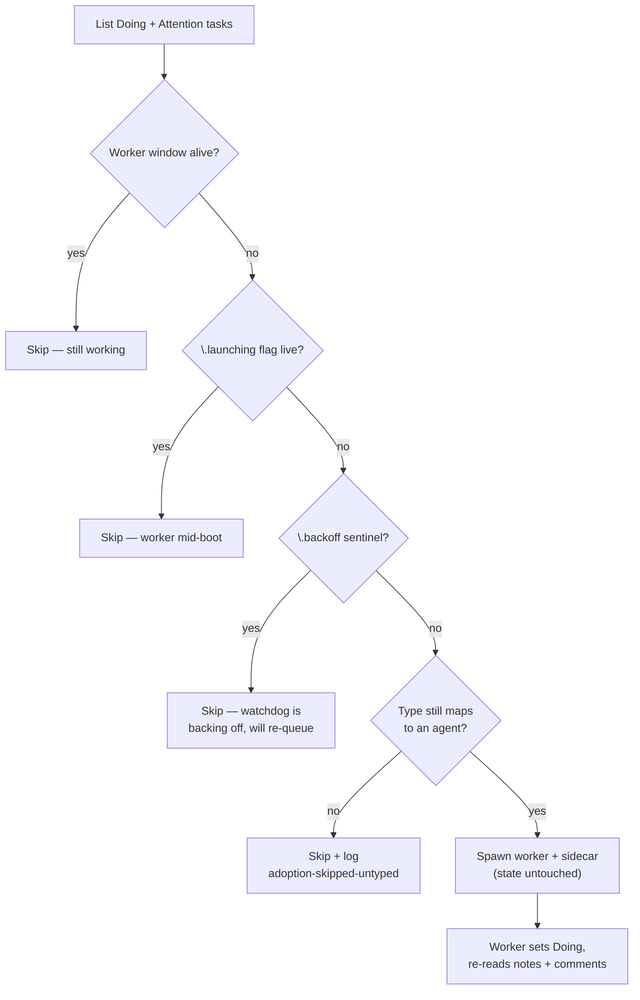
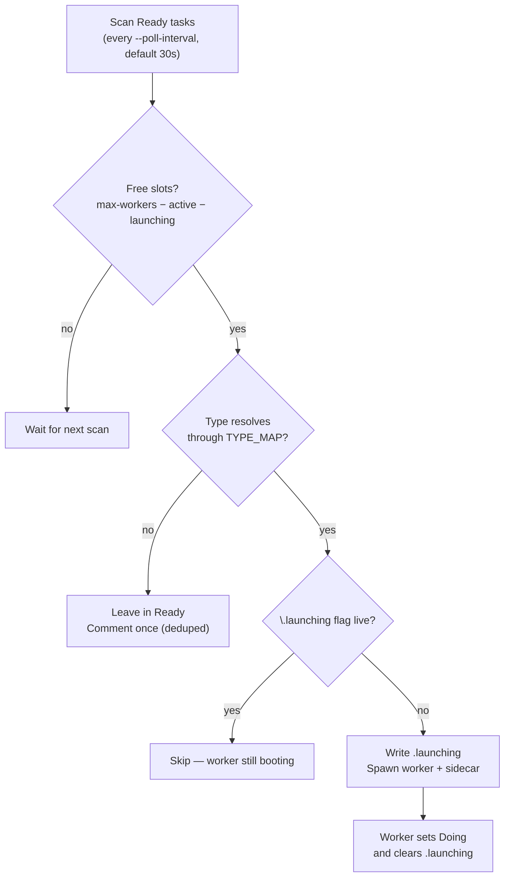
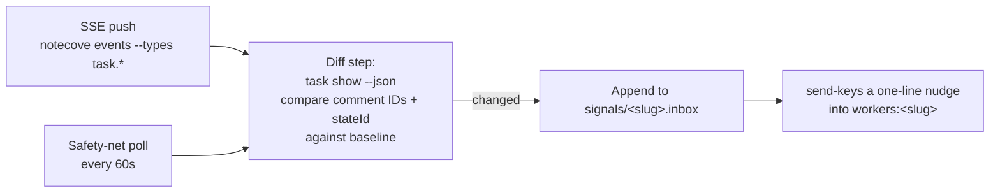
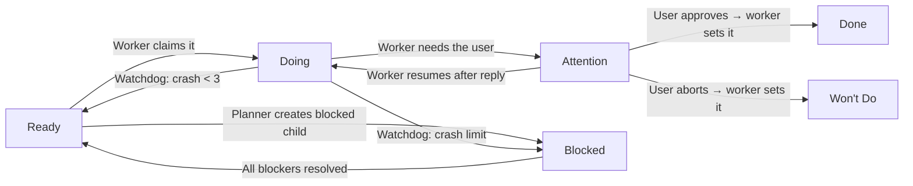
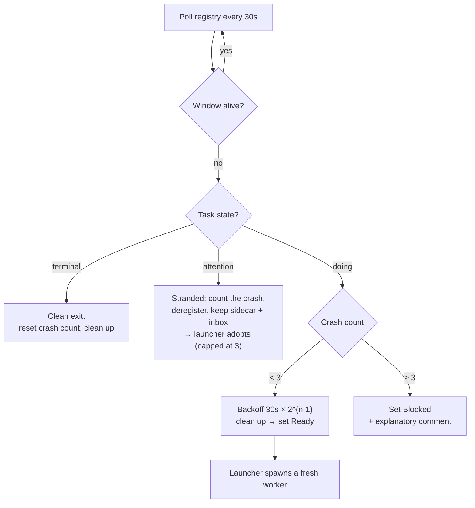
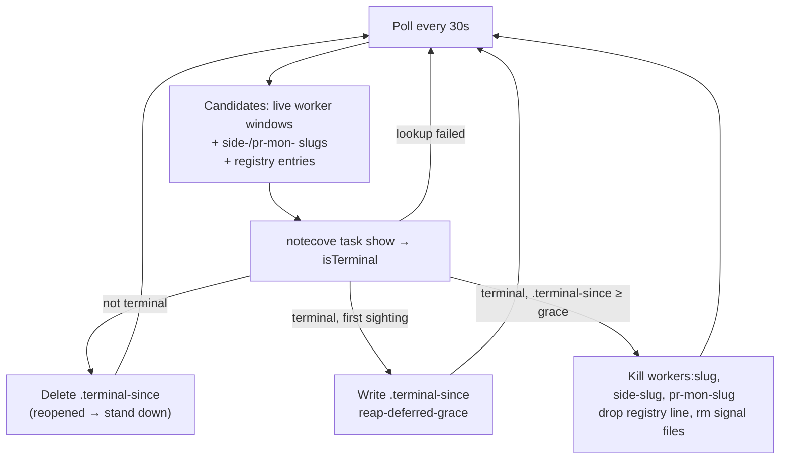
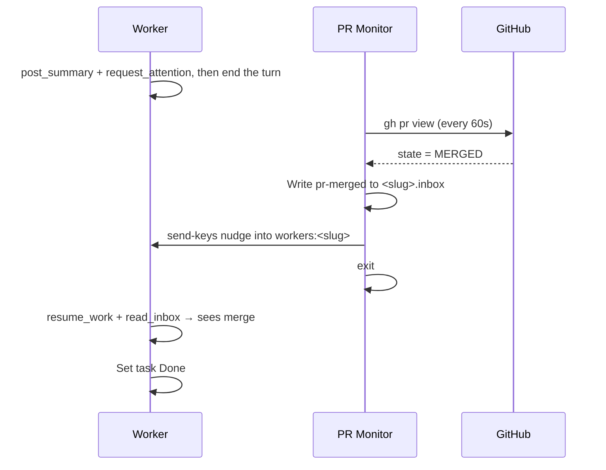
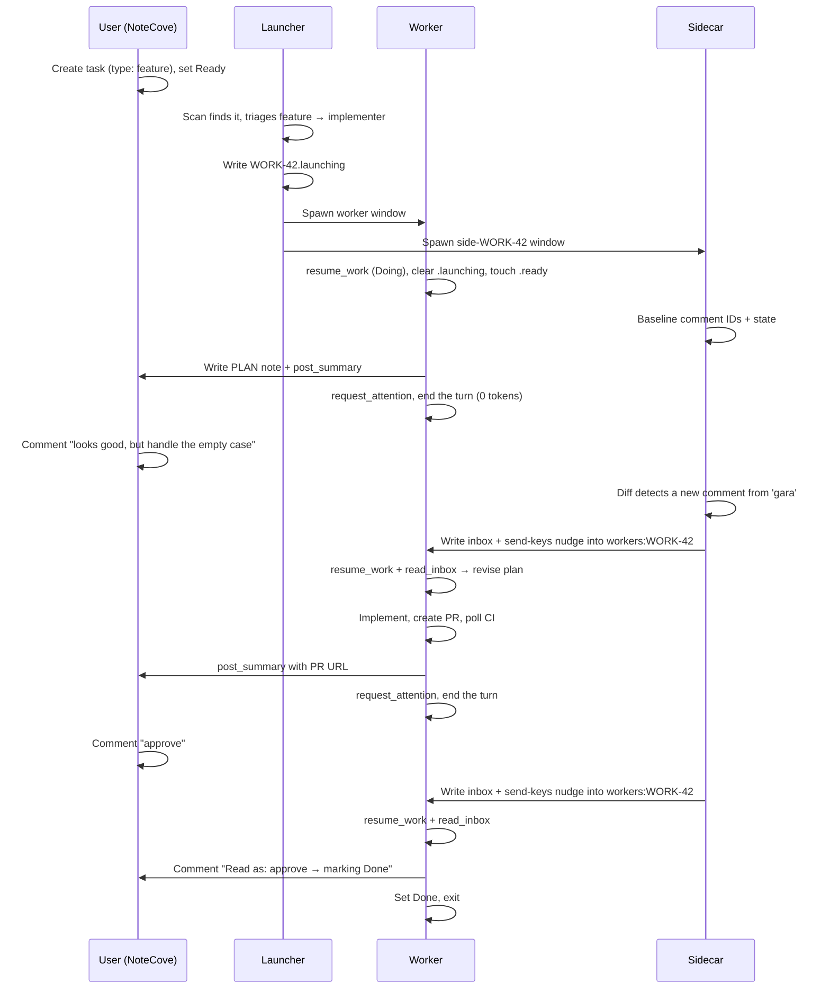
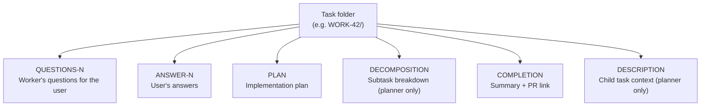

# AgentMesh — Agentic Workflow

AgentMesh picks up tasks from NoteCove and hands each to an autonomous worker agent running in its own tmux window.

**NoteCove is the only interaction surface between the user and the agents.** There is no chat interface, no relay process, and no interface layer. Each agent talks to the user directly through its task: comments carry the conversation, notes carry artifacts, task state carries intent.

---

## System Layout

```
Session: orchestrator       ← daemons only; no user-interaction process
  window 0: watchdog        ← scripts/watchdog.sh
  window 1: folder-cleanup  ← scripts/folder-cleanup.sh
  window 2: reaper          ← scripts/reaper.sh
  window 3: launcher        ← scripts/launcher.py (restart loop)
  window N: side-WORK-xyz   ← scripts/sidecar.sh (one per active worker)
  window N: pr-mon-WORK-xyz ← scripts/pr-monitor.sh (one per PR-ready task)

Session: workers            ← Claude agents only
  window 0: WORK-pm4        ← /implementer
  window N: WORK-abc        ← /designer, /investigator, /documenter, …
```

Keeping `workers` exclusively Claude agents is deliberate: the watchdog's window-liveness check and `agentmesh status` both read it that way. Sidecars and PR monitors therefore live in the `orchestrator` session even though they are per-task.

Every window here — agents and daemons alike — is launched with its process **as the window's command**, never typed into a shell. That is what makes window-existence a sound liveness check: the window dies with the process. A shell-hosted window outlives whatever died inside it, which would make `agentmesh status` report a crashed daemon as healthy and leave the reaper unable to tell a parked worker from a running one.

---

## How the User Interacts

Entirely through NoteCove. There is nothing to attach to and no session to watch.

An agent that needs the user:

1. **Posts a brief comment** summarising what it did and what it needs.
2. **Sets the task to `Attention`** via `request_attention`.
3. **Ends its turn**, consuming no tokens until something arrives.

The user replies by commenting on the task. The sidecar types a one-line nudge into the worker's Claude REPL, which starts a fresh turn: the agent calls `resume_work` (back to `Doing`), reads its inbox, and carries on.

```
agent → comment + Attention → end of turn → user replies in NoteCove → sidecar → send-keys into the agent's REPL → agent
```

The agent never blocks. That is what lets the user reach it **while it is working** — see [Delivery](#delivery--reaching-a-working-agent) below.

### Comment conventions

- **Comments are summaries, not documents.** A few sentences at most. Anything longer — reasoning, findings, option analysis, code — goes in a NoteCove note that the comment names.
- **Agents post under their role name** (`--user "Implementer"`, …), which is how the sidecar tells an agent's own comments apart from the user's.
- **The user writes free text**, interpreted with judgement ("the linter is failing", "there are conflicts, resolve them").
- **Two reserved commands** are honoured literally rather than read as feedback: `approve` (the agent sets `Done`) and `abort` (the agent sets `Won't Do`).
- **Agents echo their reading back** ("Read as: approve → marking Done") so a misinterpretation is visible rather than silent.
- **Every round of work owes the user a comment.** `resume_work` clears `signals/<slug>.summary-posted` and `request_attention` refuses to leave without it: if the agent posted nothing since it resumed, a generic placeholder goes up in its place and `summary-fallback` is logged. The placeholder is the visible failure, not the fix — an agent handing back a task with no explanation used to be invisible.
- **996 characters is the hard limit.** Measured, not documented: NoteCove accepts a 996-character comment and rejects a 997-character one with `rc=1` and no output at all. `post_summary` truncates at 900 and logs `summary-truncated` rather than letting a summary vanish, verifies the call succeeded, and retries once before warning.

### Answering worker questions

When a worker writes a `QUESTIONS-<N>` note, the user has two ways to answer:

- **Comment on the task** — the sidecar sees it and delivers it to the worker directly.
- **Inline in the QUESTIONS note** — edit the note, writing answers beneath each question.

The inline approach keeps the conversation in one place and is the more common one in practice. Because a note edit does not reliably wake the agent, every agent re-reads its QUESTIONS note after waking, whatever the inbox says.

---

## Launcher — Worker Relationship

The launcher's entire job is picking up work and starting workers. After spawning, it never communicates with an agent again.

Each scan does three passes: **reconcile** sidecars, **adopt** orphaned work, then **pick up** new work. The order matters — a live-but-deaf worker gets repaired before anything else, and adoption beats pickup because finishing work already in flight beats starting more of it. Adoption and pickup draw from the same slot budget.

### Reconciliation — keeping live workers supervised

A sidecar is the only thing that delivers the user's replies into a worker's REPL, so a worker whose sidecar died sits in `Attention` forever — silently, since its own window is still alive, its last turn ended normally, and nothing reports it. **Adoption cannot cover this**: it skips any slug with a live worker window, which is precisely this case.

For each live worker window the launcher spawns a sidecar if `side-<slug>` is missing, and re-registers the worker if `signals/workers` has no entry for it. The second repair matters after any bootstrap that runs while workers survive: `bootstrap.sh` truncates the registry, leaving those workers invisible to the watchdog and uncounted against `max-workers`, so the launcher over-subscribes.

### Adoption — recovering orphaned work

A task in `Doing` or `Attention` means a worker was working on it. If its tmux window is gone, that worker died, and nothing else would ever look at the task again: the pickup scan only queries `Ready`, and `bootstrap.sh` truncates `signals/workers`, so after a restart the watchdog has no record of it either.



**State is deliberately untouched** — the launcher only spawns. The respawned worker sets its own `Doing` and restores context from its task folder notes, so the user never has to re-queue anything by hand.

The pass runs every scan, not just at startup, because a worker can be reaped while its task sits in `Attention` at any time — not only across a restart.

Two guards exist because adoption and the watchdog overlap. The watchdog's crash backoff sleeps 30–60s with the task still `Doing` and its window already gone — adoption's exact trigger — so it writes a `.backoff` sentinel that adoption honours, and re-checks window liveness after waking so it never tears down a worker adoption created. And if `tmux list-windows` cannot be queried at all, adoption skips the whole cycle rather than reading an empty result as "every worker is dead".

> The pre-refactor Spokesman did this in its "Phase 0.5: Startup Recovery". This is that logic moved into the launcher and extended to cover `Doing` as well as `Attention` — the old version only recovered `Attention`, so a task killed mid-implementation was stranded even before the refactor.

### Task pickup



Tasks are sorted by priority ascending (P1 before P4; no priority sorts last).

### Untyped tasks are refused, not guessed

A task is only picked up when its `typeIds` or `typeNames` resolve through `TYPE_MAP`. Anything else — no type at all, or a type like `chore` that maps to nothing — is **left in `Ready`** with no default agent. There is no LLM triage fallback.

The refusal posts exactly one comment, deduped via `signals/<slug>.untyped`, and is logged on every scan. Setting a supported type makes the task eligible again on the next scan. `agentmesh status` reports how many tasks are currently refused.

### The launcher does not set task state

The worker sets `Doing` itself as its first action. That leaves the task in `Ready` while Claude boots (10–60s observed), so the launcher writes `signals/<slug>.launching` before spawning and skips any slug holding a live flag. The worker clears it on claiming the task.

The flag expires after 5 minutes (`LAUNCHING_TIMEOUT_SECS`), so a worker that dies during boot does not wedge the task permanently — the next scan retries it.

### Supported types

| NoteCove type | Agent |
|---|---|
| `feature`, `bug` | implementer |
| `plan` | planner |
| `brainstorming` | brainstormer |
| `documentation` | documenter |
| `design` | designer |
| `investigation` | investigator |
| `ticketing` | ticketer |
| `skilling` | skill-creator |
| `rfc` | rfc-creator |

---

## Sidecar

One per active worker, in window `side-<slug>`. Pure bash, no Claude.

The sidecar is **completely generic** — it carries no task-type knowledge. It never interprets comment content, never changes task state, and never decides what a change means. It reports "this changed" and wakes the agent; the agent, which already knows its own type because it is running a type-specific skill, decides what to do.

Its only parameter beyond the slug is `--agent-handle`, the comment author name it treats as "mine". That is a parameter, not type-specific code.

### Change detection

Two mechanisms, both funnelling into one diff step:



A single `notecove task show "$TASK_REF" --json` call returns `stateId`, `commentCount`, and the **full `comments` array** with author names — so one call per check is enough to detect both kinds of change and attribute them.

**A frame is matched on `item.id`, which is the only identifier it carries:**

```json
{"id":"…","type":"task.modified","item":{"type":"task","id":"7jphatbqq77qtm4g4x76zz6de5"},"payload":{"projectId":"…"},"seq":7}
```

There is no slug in it. The sidecar used to test each frame with `grep -qF "$SLUG"`, on the assumption that an id-only frame would still match as a substring — it cannot, because the short slug carries a project prefix and a hyphen the id does not (`WORK-7jp` vs `7jphatbqq77qtm4g4x76zz6de5`). That grep never matched once, so **SSE never triggered a single diff** and every sidecar was silently poll-only from the day it was written. `nc_task_id` now resolves and caches the id in `signals/<slug>.task-id`, and frames are parsed as JSON and compared field-wise — a substring test would also match on a `projectId` that happens to contain the id. A sidecar that cannot resolve its id logs `task-id-unresolved` and stays poll-only rather than guessing.

**The poll runs always, not only when SSE is unavailable.** The documented NoteCove event types (`task.created`, `task.modified`, `task.deleted`) include nothing comment-specific, so whether adding a comment emits a frame is an inference. The poll makes correctness independent of that inference. Duplicate triggers are harmless: the diff is against stored baseline state, so a change is reported exactly once however many times the check runs.

**Baselines** live in `signals/<slug>.seen-comments` (comment IDs already reported) and `signals/<slug>.seen-state`. The first run establishes them without nudging — comments that exist before the sidecar starts are history the agent already has, not events to replay at it.

**Replies are walked too.** A reply to a comment is as much a message as a top-level comment, and the user may answer either way.

### Slug identity

A task's `slug.short` is a *uniquePrefix*: unique only at the moment it is read. Creating tasks lengthens prefixes, so a short slug recorded when a worker booted can later match several tasks. The CLI does not fail on that — it **prompts**, and since every daemon runs in a tmux window with a TTY, the call blocks until it times out. `WORK-7w2` reached that state and its sidecar logged 43 consecutive `notecove-call-timed-out` events without ever seeing a comment.

`scripts/notecove-ref.sh` is the single fix point, sourced by every daemon and by the agent helper:

- **`nc_run`** runs the CLI with stdin closed and a `NC_CALL_TIMEOUT` bound, turning a silent permanent hang into a loud immediate `rc=1`.
- **`nc_ref`** resolves a short slug to the stable full slug (`WORK-7jp:hatbqq77qtm4g4x76zz6de5`), from `signals/<slug>.full-slug` — written by the launcher at spawn, the one moment the full slug is known for certain — or by listing tasks and caching the result. Two matches resolve to **nothing** rather than a guess: the distinguishing part was never recorded, and acting on the wrong task is worse than failing.

Short slugs stay in use as *local* identifiers — tmux window names and `signals/` filenames — because renaming those would invalidate every running worker's state. Only what reaches the CLI changes. Agents get the resolved value as **`$TASK_REF`** from `agent_init`, and `launcher.py` passes `stdin=subprocess.DEVNULL` to every subprocess for the same reason `nc_run` does.

### Two filters, one rule

The sidecar reports what *others* did to the task, never what the agent did to it:

- **Comments** authored by `--agent-handle` are skipped. A mismatch between that handle and the `--user` value the agent's comments carry makes the agent wake itself on every comment it writes.
- **State changes** matching `signals/<slug>.self-state` are suppressed. The agent writes the state name it is about to set to that file *before* calling the CLI, so there is no window in which the sidecar can see the new state without also seeing the marker.

The second filter did not exist while agents blocked on a signal: an agent's own `Doing`/`Attention` write landing in its own inbox was harmless, because it was consumed by the next `read_inbox` after a real wake. Once the sidecar types into a live REPL it became a self-inflicted mid-work interruption, so the filter became necessary.

The marker is matched against the task's **current** state rather than against an observed transition, and consumed as soon as it matches. Keying off the transition would leak markers — a fresh sidecar baselines straight onto the agent's new state, and an agent can move twice between two polls — and a leaked marker would later swallow a genuine user move to that same state.

### SSE permission

The event stream requires the `events:subscribe` permission, requested by `bootstrap.sh` via `notecove init --events`. Granting it may need a one-time approval in the NoteCove desktop app.

Until it is granted, the sidecar probes once, logs `sse-unavailable:no-permission`, and relies on the poll — so the system is fully functional at 60-second latency without it. `agentmesh status` reports which mode is in effect.

### Lifecycle

The `side-<slug>` window is **not** registered in `signals/workers` — it is not a worker, and registering it would make the watchdog treat its exit as a task crash. It is therefore killed explicitly: by the watchdog on crash cleanup, and by `agentmesh stop`. Nothing else would ever reap it.

---

## Agent Interaction Protocol

Agents source `scripts/agent-notecove.sh`:

| Function | Purpose |
|---|---|
| `agent_init <slug> <handle>` | Set slug and handle; resolve `$TASK_REF`; clear `signals/<slug>.launching`; open the delivery gate (`signals/<slug>.ready`) |
| `resume_work` | Back to `Doing`. The first action of every working turn |
| `post_summary <text>` | Post one brief comment as `<handle>`, truncated to 900 chars, retried once, verified |
| `request_attention [<state>] [<summary>]` | Hand the task back to the user, posting a placeholder if no summary went up this round. **Does not block** — end the turn once it returns |
| `read_inbox` | Print the inbox as line-delimited JSON and clear it |
| `ensure_task_folder` | Find or create this task's folder, link it from the task description, export `TASK_FOLDER_ID` |
| `finish_task <state> <project>` | Set the terminal state **and** run the cleanup that must go with it |
| `finish_cleanup <project>` | The cleanup alone, for when the *user* set the terminal state |
| `watch_pr <pr-url>` | Start the merge monitor for this task |

`finish_task` is not optional sugar over `notecove task change --state Done`. It is the only thing that releases tasks blocked on this one and stops this task's sidecar and pr-monitor — before the refactor the orchestrator's event handlers did that, and they are gone. A bare state change leaves dependents blocked forever and leaks two processes.

`finish_cleanup` exists for the case where the **user** sets a terminal state in NoteCove. The agent must not overwrite their state, but the cleanup is still owed — so it runs the same teardown without the `task change`.

`ensure_task_folder` replaces a recipe that used to live in the implementer-family skill text and was retyped by hand by every agent. That recipe destroyed task descriptions: it decided whether a description existed by parsing the markdown rendering, and an empty parse result — which means *either* "the description is empty" *or* "the read failed" — took a branch that replaced the whole description with nothing but the folder link. The helper reads the stored content (`task show --json` → `contentJson.content`) rather than a text rendering, writes nothing at all when anything is in doubt, keeps the previous description in `signals/<slug>.description-backup`, and verifies the link landed before returning. It is idempotent: a description already carrying a `[[F:…]]` link is left untouched. Agents must not edit the description by hand.

`await_user` survives as a **deprecated alias of `request_attention`** — it announces and returns rather than blocking. It exists only so a worker that somehow boots on pre-3.5.0 skill text degrades to "ends its turn early" instead of hanging forever on a signal nobody fires.

Every state change an agent makes goes through `resume_work` / `request_attention` / `finish_task`, all of which call `set_state`. A **bare `notecove task change --state`** skips the `.self-state` marker, so the sidecar reports the change back and the agent interrupts itself.

### Inbox format

```json
{"kind":"comment","id":"CDpiRX…","author":"gara","content":"looks good, ship it","created":1792062799252}
{"kind":"state-change","from":"doing","to":"…","to_name":"Won't Do"}
{"kind":"pr-merged","url":"https://github.com/foo/bar/pull/1","note":"PR was merged. Set the task to Done."}
```

---

## Delivery — reaching a working agent

`scripts/notify-worker.sh` is the single place that knows how to deliver. The sidecar and the pr-monitor both source it; neither contains any delivery logic of its own.

```bash
tmux send-keys -t workers:<slug> -l "<one-line nudge>"
sleep 0.3
tmux send-keys -t workers:<slug> Enter
```

### Why messages replaced `tmux wait-for`

The previous protocol fired `<slug>-nudge-<seq>` at an agent blocked inside `tmux wait-for`. A tmux signal has no queue and no recipient: it can only reach an agent that is *already waiting*. Everything the user said while the agent was working was therefore invisible to it until it next chose to wait — mid-implementation, that could be many minutes, or never.

Typing into the Claude REPL reaches the agent in both states. Idle at its prompt, the input starts a new turn. Mid-turn, Claude Code queues it and picks it up when the current turn ends. The consequence for skill authors is that **the agent no longer blocks at all**: `request_attention` announces and returns, the turn ends there, and the reply arrives as a fresh turn. This also retires the 10-minute Bash-tool cap that used to interrupt every real wait and force a re-entry.

### The payload stays in the inbox

What is typed is a fixed one-line nudge, never the user's text. Comment bodies are multi-line free text written by a human and must never be typed into a REPL. Keeping them in `signals/<slug>.inbox` is also what keeps the sidecar generic — it writes arbitrary text to a file and types a constant.

The nudge names the helper to source rather than assuming the functions are still defined, because an agent woken after a long gap may have lost all shell state.

This makes delivery **idempotent**. A duplicate nudge for a change the agent has already drained finds an empty inbox, and an empty `read_inbox` is defined as "nothing new, carry on" rather than an error — which is what lets the SSE path, the safety-net poll, and the retry loop all fire freely without coordinating.

### Two gates and a sentinel

Typing into the wrong place is worse than not typing at all, so delivery requires:

- **the worker window exists** — there is nothing to type into otherwise;
- **`signals/<slug>.ready` exists** — `spawn-agent.sh` types the skill invocation into the REPL once the prompt appears, and a nudge landing in that gap would be typed into the middle of that command line. `agent_init` touches `.ready`, so the gate opens only once the skill is actually running. `spawn-agent.sh` removes any stale one before spawning.

A `tmux` that cannot be queried at all **fails closed** — "no answer" is not read as "the window is there".

Verified against a live REPL: a nudge delivered mid-turn is shown as a queued message and consumed as the next turn, and a nudge delivered at an idle prompt starts a turn immediately. One caveat found while verifying — if the input box is **not empty** when the nudge is typed, the nudge is appended to whatever is there and both are submitted together. It still reads correctly (the agent acts on the nudge), but it is why `.ready` gates the one window where this reliably happens: the gap in which `spawn-agent.sh` has typed the skill invocation but not yet submitted it.

`Escape` would clear the input box first, but it also interrupts the turn in progress — which is precisely what delivery must not do — so nothing is cleared before typing.

Unlike a fire-and-forget signal, delivery can therefore fail, and the change it was reporting is already absorbed into the sidecar's baseline by then — so it would never be reported again. `signals/<slug>.pending-delivery` is written before every attempt and cleared only by a delivered nudge; the sidecar retries any outstanding one on each poll. The pr-monitor has no further poll to retry from, so it retries up to ten cycles itself and logs `merge-nudge-undelivered` if the worker never became reachable.

---

## Task State

Task state is owned by **the worker agent and the user — nothing else.**



| State | Who sets it | Meaning |
|---|---|---|
| `Ready` | User / Planner / Watchdog (retry) | Queued for pickup. The launcher reads it but never writes it. |
| `Doing` | Worker | An agent is working on this right now. Set on claiming the task, and again at the top of every turn that resumes work |
| `Attention` | Worker | The agent is finished for now; the user has the task |
| `Done` | Worker (after approval) / User | Fully approved and complete |
| `Won't Do` | Worker (on `abort`) / User | Cancelled |
| `Blocked` | Planner / Watchdog (crash limit) / User | Waiting on a dependency, or needs investigation |

The watchdog setting `Ready`/`Blocked` on a crash is the one exception to worker-and-user-only: a crashed worker cannot set its own state, and the alternative is a task stuck in `Doing` with nothing running.

### Priority

Standard **P1–P4** scale. The launcher picks up the highest-priority `Ready` tasks first; tasks with no priority sort last.

---

## Worker Types

All nine worker skills inherit the same interaction protocol from `shared/base-agent.md` via `shared/base-implementer.md`, and differ only in what they produce.

| Skill | Produces |
|---|---|
| implementer | Code changes and a PR |
| planner | A decomposition and child tasks |
| brainstormer | IDEAS and SELECTION notes, then child tasks |
| designer | A DESIGN note, then frontend child tasks |
| investigator | Context notes answering a research question |
| documenter | Docs files + PR, or a Confluence page |
| ticketer | Jira tickets via the Atlassian MCP |
| skill-creator | New or improved agentmesh skills |
| rfc-creator | An RFC, in Confluence or as a repo file |

### Adding a new agent type

Three registrations, not one:

1. `TYPE_MAP` in `scripts/launcher.py` — NoteCove type → agent handle
2. `AGENT_AUTHOR` in `scripts/launcher.py` — agent handle → comment author name
3. `agent-user` in the skill's frontmatter — must equal the `AGENT_AUTHOR` value

A missing or mismatched `AGENT_AUTHOR` entry makes the agent wake itself on every comment it writes, which presents as a wakeup loop. `test_triage.py` asserts every agent in `TYPE_MAP` has an `AGENT_AUTHOR` entry.

---

## agentmesh CLI

```bash
agentmesh start --project WORK    # bootstrap daemons and return
agentmesh stop                    # kill all windows and the workers session
agentmesh switch --project OTHER  # switch projects, preserving running workers
agentmesh status                  # health report
agentmesh attach                  # attach to the orchestrator tmux session
agentmesh task create <title> --project WORK --type feature
```

`start` has no user-interaction process to launch: it brings up the daemons and returns.

`status` reports the launcher heartbeat, the daemons, active workers, **sidecar count** (warning if fewer sidecars than workers — those workers get no user replies), **SSE availability**, and the count of tasks refused for a missing type.

`switch` kills only the launcher, which is the one project-scoped component. Sidecars keep serving workers from the previous project — they are project-agnostic, keyed only on a task slug — and PR monitors keep watching for merges.

---

## Bootstrap

`scripts/bootstrap.sh` initializes the runtime:

1. `notecove init --profile … --tasks-project … --notes --events`
2. **Cold start only** — clear `signals/`: truncate the registry and event log, kill stray sidecars, delete every per-task flag
3. Resolve and persist the Triage folder ID
4. Create the `orchestrator` and `workers` tmux sessions
5. Ensure `watchdog`, `folder-cleanup` and `reaper` — spawn each only if its window is absent
6. Ensure `launcher` inside a restart loop — spawn if absent, replace if its heartbeat is stale

```bash
agentmesh start --project WORK
```

The launcher runs as `while true; do python3 launcher.py …; sleep 5; done` — nothing supervises it, and it has no Claude dependency, so respawning in place is the simplest form of supervision.

### Idempotent, self-repairing start

**`agentmesh start` is safe to run against a live system**, and that is the only way to bring back a daemon that died or to pick up a newly added one. Stopping first would work, but it destroys every running worker.

The script creates what is missing and touches nothing else:

- **Step 2 runs only on a cold start** — one where nothing is running. On a warm start, truncating `signals/workers` hides live workers from the watchdog and deleting `*.inbox` throws away the reply a worker in `Attention` has yet to read, and deleting `*.ready` shuts the delivery gate on a worker whose skill is already running. A sidecar that outlived such a wipe is worse still: with its baseline files gone its next diff computes `first_run=true`, absorbs the pending reply into history, and never writes it to the inbox. Hence sidecars are killed inside that same branch, not outside it.
- **Liveness errs towards "live"**: a non-empty registry, *or* a surviving `side-*`/`pr-mon-*` window, *or* a `claude` pane in the `workers` session. Wrongly skipping the wipe costs a few stale files; wrongly running it loses work.
- **The launcher is the one daemon whose window is not proof of life** — it can be up and wedged. Its heartbeat measures exactly that, being stamped after each *completed scan*, so a launcher window whose heartbeat is older than 90s is replaced and a healthy one is left alone.
- **The heartbeat is never pre-stamped**, by bootstrap or by `switch`. Stamping on spawn makes a launcher that dies on startup look healthy for a full minute.

`agentmesh start --clean` forces the reset on a live system, for when a blank slate is actually what you want.

> A healthy launcher is left running even if `launcher.py` changed on disk. To pick up new daemon code without a reset, kill the window and re-run `agentmesh start`.

---

## Watchdog

Detects crashed workers by polling `signals/workers` every 30 seconds and checking whether each registered window still exists.



On crash retry the task goes back to `Ready` and the launcher picks it up on its next scan — the watchdog does not spawn workers itself.

At the crash limit the task is set to `Blocked` with a comment explaining why. **That comment is the user-visible escalation** — no process relays notifications any more.

An `Attention` task whose window is gone is **not** a clean exit: the task is mid-conversation and its worker died. The watchdog deregisters it so it is not re-reported every poll, but leaves the sidecar, inbox, and seq intact — the launcher's adoption pass will spawn a fresh worker, and a pending user reply sitting in the inbox has to survive until that worker reads it.

This path still **counts crashes**. Adoption respawns on a 30s cadence, so a worker that reproducibly dies right after `request_attention` would otherwise be respawned forever with no cap and nothing reported. At three the task is set `Blocked` with a comment warning that the user's reply may never have been read.

Crash cleanup kills `side-<slug>` and `pr-mon-<slug>` and removes the task's `.inbox`, `.ready`, `.pending-delivery`, `.self-state`, `.launching`, `.seen-comments`, `.seen-state`, `.terminal-since`, `.full-slug`, `.task-id`, and `.summary-posted` files.

**Crash detection latency**: at most 60 seconds (two poll cycles).

---

## Folder Cleanup

Polls every 60 seconds for tasks in any terminal state (Done, Won't Do) and moves each task's named subfolder into the adjacent `Done` folder. Skips folders already under a `Done` folder, so it is idempotent.

---

## Reaper

The watchdog handles workers that *died*. The reaper handles workers that *finished* — which, left alone, never go away.

A worker does not exit on its own: `spawn-agent.sh` launches the interactive Claude REPL, so when the skill's last turn ends Claude returns to its prompt and idles there indefinitely. `task-done.sh` deliberately leaves the worker window alone, because the worker is the process running that script. The watchdog only inspects windows that are already gone. Before the reaper, the only thing that collected a finished worker was `agentmesh stop` — so every completed task leaked a Claude process against `max-workers`, and a task reopened from `Done` could never be picked up again, its window name still being taken.



It never changes task state and never comments — it only tears down. Being a separate process is the whole point: the reaper is not the thing being killed, so it works whether or not the worker cooperated, noticed its own state change, or is wedged.

**The grace period (default 60s) is load-bearing.** A worker sets `Done` and *then* runs `task-done.sh`, which retries dependent-unblocking with sleeps in between; reaping on sight would kill it mid-cleanup and leave the dependents blocked forever. It also covers the user who closes a task and immediately reopens it.

**Candidate-driven, not task-driven.** Listing every terminal task would hit the NoteCove CLI's default page size and silently miss anything past it. The only slugs that can need reaping are those with something still running or registered — at most `max-workers` of them. Including `side-*`/`pr-mon-*` windows and registry lines in the candidate set is what catches a task closed after its worker had already died: the worker window is gone, but its sidecar and slot would otherwise linger forever.

**Never reaps on absence of evidence.** A failed or timed-out NoteCove call is skipped, not read as terminal. If `tmux` cannot be queried at all the whole pass is abandoned — treating an unanswerable tmux as "no windows exist" would reap every tracked task at once.

**Branches on `isTerminal`, never on a `stateId` string.** Only NoteCove's built-in states have literal IDs; `Attention` and `Won't Do` carry generated ones that differ per project, so string matching silently misses them.

```bash
bash scripts/reaper.sh --once --dry-run   # report what would be reaped, kill nothing
```

---

## CI Gate

After creating a PR, the worker polls required CI checks before telling the user the PR is ready, so the user only ever reviews PRs that are green.

1. After `gh pr create` the worker captures the PR URL in `$PR_URL`.
2. After a 15-second initial delay (to let GitHub register the checks), it polls `gh pr checks $PR_URL --required --json name,state,bucket` every 30 seconds.
3. The `bucket` field (normalized by `gh`) is used — `pass`, `fail`, `pending`, `skipping`, `cancel`. No required checks is treated as a pass.
4. On **pass** → the worker posts the PR summary, calls `request_attention`, and ends its turn.
5. On **fail** or **timeout** (9.5 minutes per call; re-called up to twice for ~30 minutes total) → the worker writes a `QUESTIONS-<N>` note with the failed check names, calls `request_attention`, and ends its turn.
6. The user responds with **fix** (the worker pushes a fix and re-polls CI) or **override** (the worker proceeds anyway).

**Value**: eliminates the "approve → CI fails → feedback → fix" round-trip.

---

## PR Monitor

One per PR-ready task, in window `pr-mon-<slug>`. Polls `gh pr view <pr-url>` every 60 seconds.



It does **not** set task state — the worker wakes, sees the merge, and sets `Done` itself. Merge detection lives here rather than in the sidecar so the sidecar stays generic, with no notion of PRs.

**The agent starts it**, via `watch_pr "$PR_URL"` immediately after creating the PR. Nothing else spawns it: the orchestrator used to, and that code is gone. Without the call a merge on GitHub is invisible and the task sits in `Attention` indefinitely, which is only correct if the user always responds by commenting `approve`.

---

## Agent Spawner

`scripts/spawn-agent.sh <session> <window> <skill> <slug> <project>` creates a tmux window, starts `claude --dangerously-skip-permissions`, waits for the REPL prompt (matching the `❯` + NBSP byte sequence, with a 60-second fallback), then sends the skill invocation.

---

## Task Cleanup Helper

`scripts/task-done.sh <slug> <project>` is called by the worker itself through `finish_task`. It unblocks dependents **first** — that is the step nothing else performs — then stops the sidecar and PR monitor, unregisters from `signals/workers`, and removes per-task signal files.

It deliberately does not kill the calling worker's own window: the worker is running the script, so killing its window would terminate it mid-run. The worker exits on its own and the watchdog reaps the registry entry.

---

## End-to-End Example



---

## Why NoteCove?

| Benefit | Detail |
|---|---|
| **One surface** | The user's task list *is* the interface. No chat window to watch, no relay process to keep alive, no second channel to keep in sync. |
| **Lightweight tasks** | Tasks hold title, state, priority, and a brief description. Detail lives in notes — tasks stay scannable. |
| **Conversation in place** | Questions, answers, and decisions live on the task they concern, readable months later without reconstructing a session. |
| **State as coordination primitive** | Task state transitions *are* the messages. No status files, no JSON payloads, no side channels. |
| **Crash resilience** | Workers restore context from existing notes on restart. No work is lost if a worker crashes. |
| **Proactive knowledge capture** | Workers file triage tasks for bugs, doc gaps, or concerns into a shared Triage folder — visible to user and future agents immediately. |

---

## Notes for Context Persistence

Each task gets a dedicated folder. Workers create notes there throughout their lifecycle:



Notes keep detailed context out of the task record, and out of comments. If a worker crashes and is restarted, it reads existing notes to restore context — no work is lost.

---

## Reliability

**Launcher heartbeat.** `launcher.py` writes `signals/launcher.heartbeat` at the end of each completed scan, and `agentmesh status` reports it stale past 90 seconds (3 missed scans at the default interval).

Stamping only on a completed scan is deliberate. Stamping at startup — or from a background thread — let a launcher crash-looping every 5 seconds keep the file perpetually fresh, so status reported `✓ running` while nothing was picked up at all. Freshness now means *work is being picked up*. `bootstrap.sh` does not pre-stamp it, and each restart of the supervision loop is logged as `process-exited-restarting`.

**Sidecar coverage.** A worker whose sidecar has died is deaf to the user: nothing will ever type the user's reply into its REPL, so it sits in `Attention` indefinitely. The launcher's reconciliation pass respawns it within a scan, and `agentmesh status` compares the sidecar count against the worker count meanwhile.

Every NoteCove call the sidecar makes is bounded by a 30s `timeout`. Without one a hung NoteCove wedged the poll loop silently — the sidecar's window stayed alive, so both the watchdog and `status` kept counting it as healthy while the agent it was meant to wake waited indefinitely.

**Bootstrap kills sidecars before clearing their state.** A sidecar that outlives the wipe of its own baseline files computes `first_run=true` on its next diff and absorbs everything new — including a reply the user is waiting on — into history, writing nothing to the inbox. Reconciliation respawns them on the first scan, so killing them costs nothing.

**Inbox durability.** The inbox is an append-only file and the nudge is idempotent, so neither a delivery landing mid-turn nor a duplicate one loses or double-counts anything: the agent drains whatever is there on its next `read_inbox`, and an empty read is defined as "nothing new".

**Delivery durability.** A nudge that could not be typed leaves `.pending-delivery` behind and is retried on every sidecar poll, because the change it reported is already absorbed into the baseline and will never be reported a second time.

**Slug stability.** Every NoteCove call made with a slug goes through `nc_run`/`nc_ref` in `scripts/notecove-ref.sh`, so an ambiguous short slug fails loudly instead of blocking on a prompt no one can see, and normally does not go ambiguous at all because the full slug is what is passed. The same hazard sat in `task-done.sh`, where dependents were matched by `slug.short`: a prefix lengthened while the worker was running made a task fail to recognise itself as its own dependent's blocker, and the dependent stayed `Blocked` forever with nothing logged.

**Summary guarantee.** A comment over 996 characters is rejected by NoteCove with no output, which used to drop the summary silently and hand the user a task in `Attention` with no explanation. `post_summary` truncates, verifies and retries; `request_attention` posts a placeholder if nothing went up at all. Both are logged, so the failure is visible in `events.log` rather than only in the user's confusion.

**Launching-flag expiry.** A worker that dies before claiming its task leaves a `.launching` flag behind. The flag expires after 5 minutes, after which the next scan retries the task rather than leaving it stranded in `Ready`.

**Recovery requires nothing from the user.** `agentmesh stop` kills every worker, but their tasks stay in `Doing`/`Attention` and the launcher's adoption pass respawns a worker for each within one scan of the next start. Do **not** set tasks back to `Ready` — that loses context, because an adopted worker resumes from its notes whereas a re-queued one starts over.

| Cause | Recovered by |
|---|---|
| `agentmesh stop` / `start`, machine reboot | Launcher adoption, next scan |
| Worker crash while `Doing` | Watchdog → back to `Ready` → normal pickup (backoff, 3 attempts) |
| Worker killed while `Attention` | Launcher adoption, next scan |
| Sidecar dies, worker still alive | Launcher sidecar reconciliation, next scan |
| Launcher restarts while workers survive | Reconciliation re-registers them |
| PR merged on GitHub instead of `approve` | `pr-monitor`, started by the agent via `watch_pr` |
| Launcher itself exits | Its `while true` restart loop in `bootstrap.sh`, after 5s |
| Launcher up but wedged (stale heartbeat) | `agentmesh start` replaces it; no stop needed |
| A daemon window killed or never started | `agentmesh start` respawns it, workers untouched |
| Worker idling after its task finished | Reaper, within the grace period plus one poll |
| Task reopened from `Done`, old window still holding the name | Reaper frees the name, then normal pickup |
| Three consecutive crashes | **Not recovered** — set `Blocked` with a comment, deliberately |

The only thing adoption cannot recover is a task whose type no longer maps to an agent: it logs `adoption-skipped-untyped` and leaves the task alone, since there is no way to know which agent owned the work. Restore the type and the next scan takes it.
