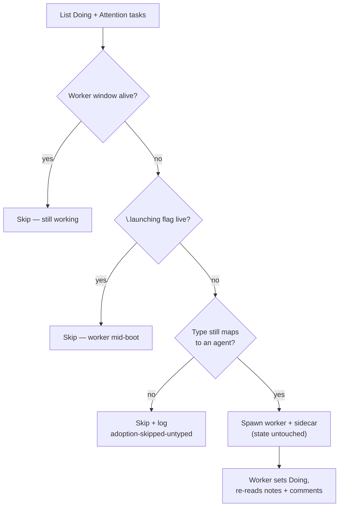
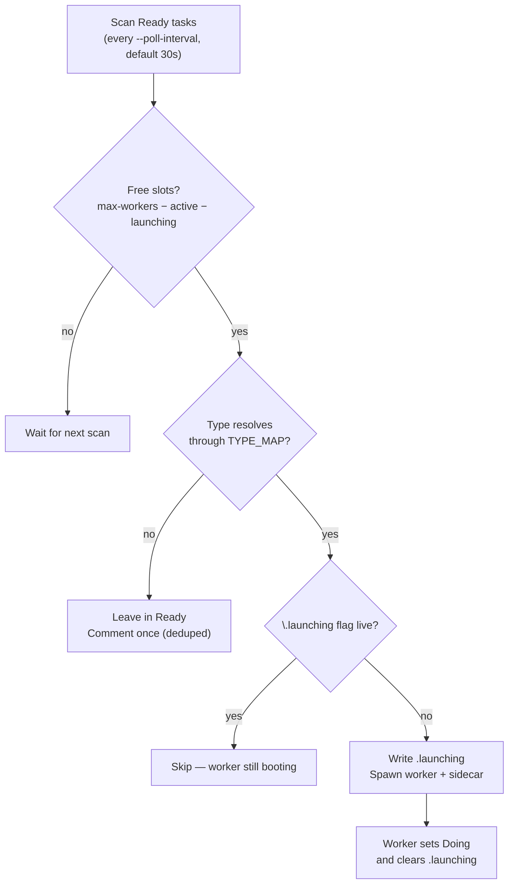
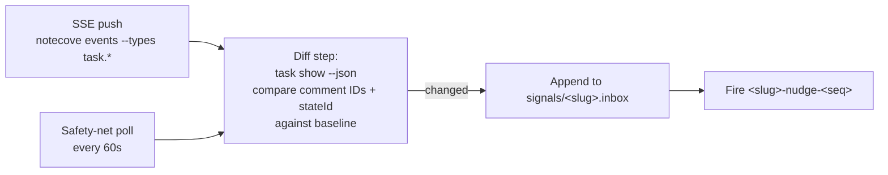
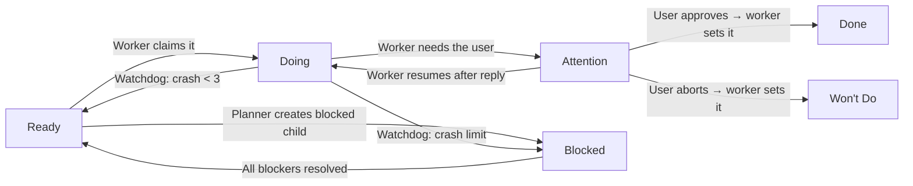
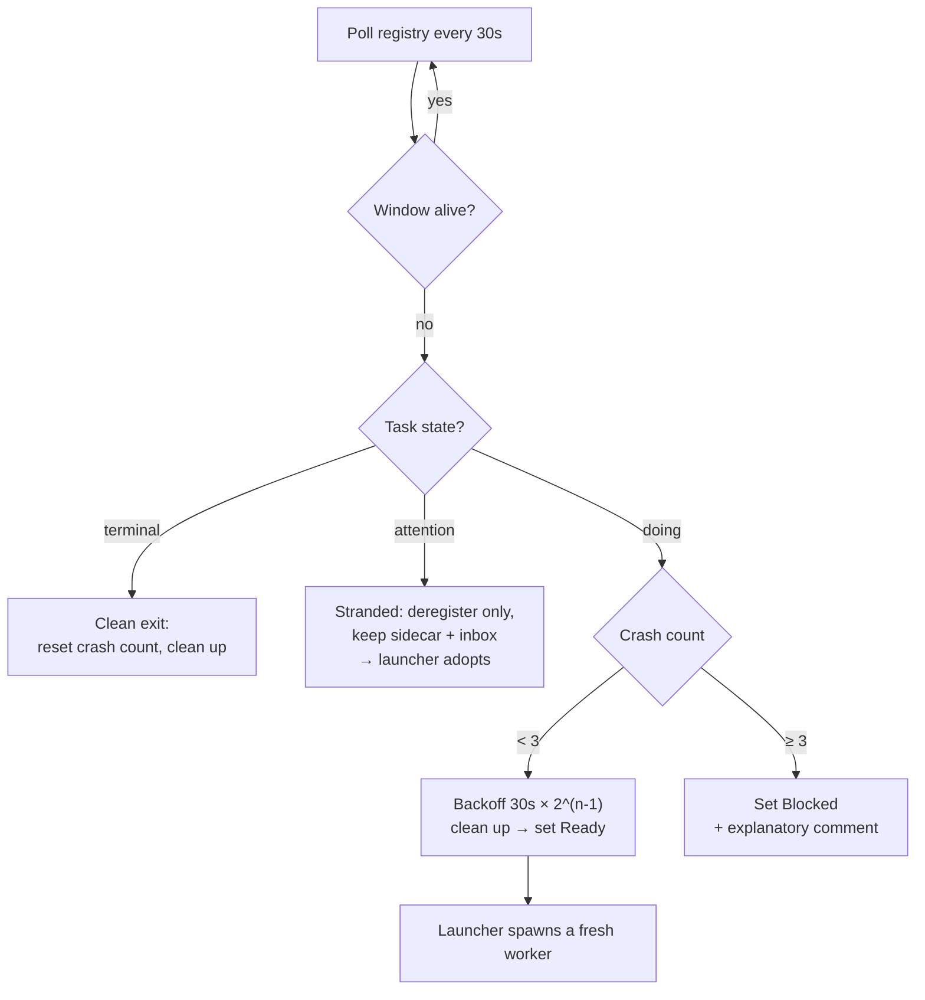
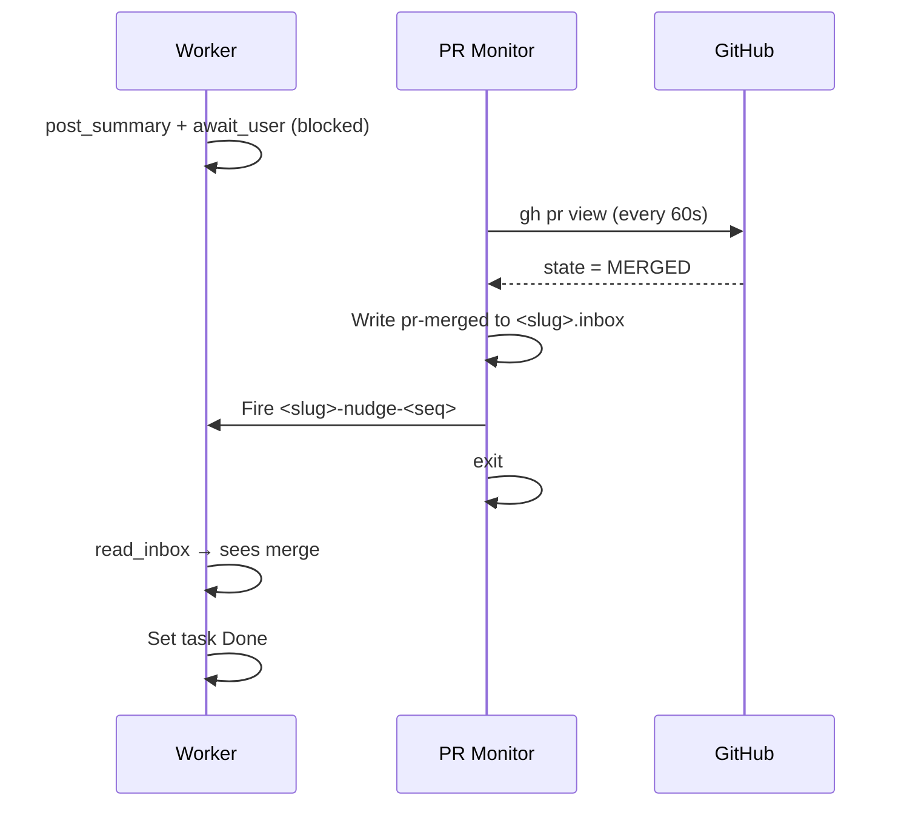
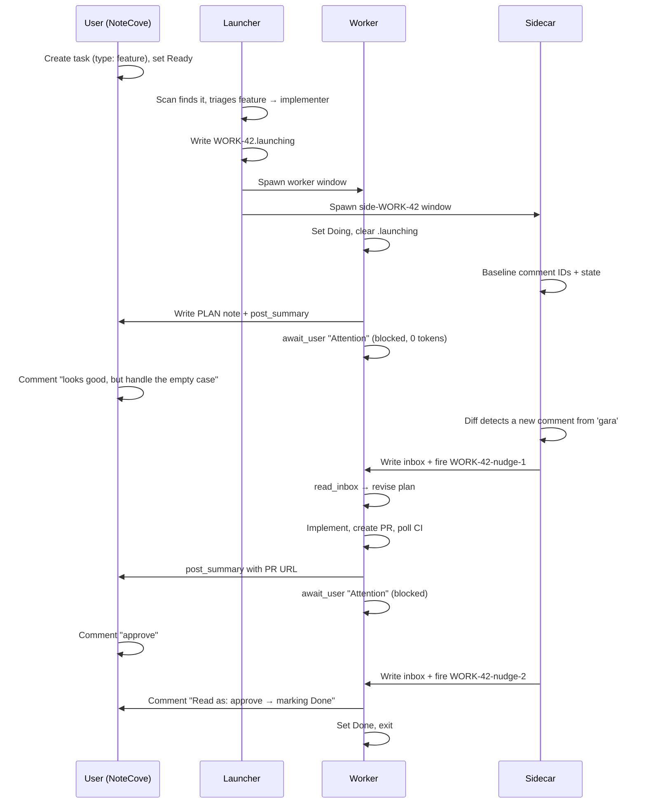
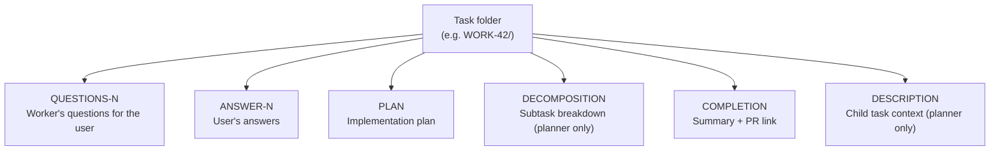

# AgentMesh — Agentic Workflow

AgentMesh picks up tasks from NoteCove and hands each to an autonomous worker agent running in its own tmux window.

**NoteCove is the only interaction surface between the user and the agents.** There is no chat interface, no relay process, and no interface layer. Each agent talks to the user directly through its task: comments carry the conversation, notes carry artifacts, task state carries intent.

---

## System Layout

```
Session: orchestrator       ← daemons only; no user-interaction process
  window 0: watchdog        ← scripts/watchdog.sh
  window 1: folder-cleanup  ← scripts/folder-cleanup.sh
  window 2: launcher        ← scripts/launcher.py (restart loop)
  window N: side-WORK-xyz   ← scripts/sidecar.sh (one per active worker)
  window N: pr-mon-WORK-xyz ← scripts/pr-monitor.sh (one per PR-ready task)

Session: workers            ← Claude agents only
  window 0: WORK-pm4        ← /implementer
  window N: WORK-abc        ← /designer, /investigator, /documenter, …
```

Keeping `workers` exclusively Claude agents is deliberate: the watchdog's window-liveness check and `agentmesh status` both read it that way. Sidecars and PR monitors therefore live in the `orchestrator` session even though they are per-task.

---

## How the User Interacts

Entirely through NoteCove. There is nothing to attach to and no session to watch.

An agent that needs the user:

1. **Posts a brief comment** summarising what it did and what it needs.
2. **Sets the task to `Attention`** and blocks, consuming no tokens.
3. **Wakes when its sidecar nudges it**, reads what changed, and continues.

The user replies by commenting on the task.

```
agent → comment + Attention → user replies in NoteCove → sidecar → <slug>-nudge-<seq> → agent
```

### Comment conventions

- **Comments are summaries, not documents.** A few sentences at most. Anything longer — reasoning, findings, option analysis, code — goes in a NoteCove note that the comment names.
- **Agents post under their role name** (`--user "Implementer"`, …), which is how the sidecar tells an agent's own comments apart from the user's.
- **The user writes free text**, interpreted with judgement ("the linter is failing", "there are conflicts, resolve them").
- **Two reserved commands** are honoured literally rather than read as feedback: `approve` (the agent sets `Done`) and `abort` (the agent sets `Won't Do`).
- **Agents echo their reading back** ("Read as: approve → marking Done") so a misinterpretation is visible rather than silent.

### Answering worker questions

When a worker writes a `QUESTIONS-<N>` note, the user has two ways to answer:

- **Comment on the task** — the sidecar sees it and nudges the worker directly.
- **Inline in the QUESTIONS note** — edit the note, writing answers beneath each question.

The inline approach keeps the conversation in one place and is the more common one in practice. Because a note edit does not reliably wake the agent, every agent re-reads its QUESTIONS note after waking, whatever the inbox says.

---

## Launcher — Worker Relationship

The launcher's entire job is picking up work and starting workers. After spawning, it never communicates with an agent again.

Each scan does two passes: **adopt** orphaned work, then **pick up** new work. Adoption runs first because finishing work already in flight beats starting more of it, and both draw from the same slot budget.

### Adoption — recovering orphaned work

A task in `Doing` or `Attention` means a worker was working on it. If its tmux window is gone, that worker died, and nothing else would ever look at the task again: the pickup scan only queries `Ready`, and `bootstrap.sh` truncates `signals/workers`, so after a restart the watchdog has no record of it either.



**State is deliberately untouched** — the launcher only spawns. The respawned worker sets its own `Doing` and restores context from its task folder notes, so the user never has to re-queue anything by hand.

The pass runs every scan, not just at startup, because a worker can be reaped while its task sits in `Attention` at any time — not only across a restart.

> The pre-refactor Spokesman did this in its "Phase 0.5: Startup Recovery". This is that logic moved into the launcher and extended to cover `Doing` as well as `Attention` — the old version only recovered `Attention`, so a task killed mid-implementation was stranded even before the refactor.

### Task pickup



Tasks are sorted by priority ascending (P1 before P4; no priority sorts last).

### Untyped tasks are refused, not guessed

A task is only picked up when its `typeIds` or `typeNames` resolve through `TYPE_MAP`. Anything else — no type at all, or a type like `chore` that maps to nothing — is **left in `Ready`** with no default agent. There is no LLM triage fallback.

The refusal posts exactly one comment, deduped via `signals/<slug>.untyped`, and is logged on every scan. Setting a supported type makes the task eligible again on the next scan. `agentmesh status` reports how many tasks are currently refused.

### The launcher does not set task state

The worker sets `Doing` itself as its first action. That leaves the task in `Ready` while Claude boots (10–60s observed), so the launcher writes `signals/<slug>.launching` before spawning and skips any slug holding a live flag. The worker clears it on claiming the task.

The flag expires after 5 minutes (`LAUNCHING_TIMEOUT_SECS`), so a worker that dies during boot does not wedge the task permanently — the next scan retries it.

### Supported types

| NoteCove type | Agent |
|---|---|
| `feature`, `bug` | implementer |
| `plan` | planner |
| `brainstorming` | brainstormer |
| `documentation` | documenter |
| `design` | designer |
| `investigation` | investigator |
| `ticketing` | ticketer |
| `skilling` | skill-creator |
| `rfc` | rfc-creator |

---

## Sidecar

One per active worker, in window `side-<slug>`. Pure bash, no Claude.

The sidecar is **completely generic** — it carries no task-type knowledge. It never interprets comment content, never changes task state, and never decides what a change means. It reports "this changed" and wakes the agent; the agent, which already knows its own type because it is running a type-specific skill, decides what to do.

Its only parameter beyond the slug is `--agent-handle`, the comment author name it treats as "mine". That is a parameter, not type-specific code.

### Change detection

Two mechanisms, both funnelling into one diff step:



A single `notecove task show <slug> --json` call returns `stateId`, `commentCount`, and the **full `comments` array** with author names — so one call per check is enough to detect both kinds of change and attribute them.

**The poll runs always, not only when SSE is unavailable.** The documented NoteCove event types (`task.created`, `task.modified`, `task.deleted`) include nothing comment-specific, so whether adding a comment emits a frame is an inference. The poll makes correctness independent of that inference. Duplicate triggers are harmless: the diff is against stored baseline state, so a change is reported exactly once however many times the check runs.

**Baselines** live in `signals/<slug>.seen-comments` (comment IDs already reported) and `signals/<slug>.seen-state`. The first run establishes them without nudging — comments that exist before the sidecar starts are history the agent already has, not events to replay at it.

**Replies are walked too.** A reply to a comment is as much a message as a top-level comment, and the user may answer either way.

### SSE permission

The event stream requires the `events:subscribe` permission, requested by `bootstrap.sh` via `notecove init --events`. Granting it may need a one-time approval in the NoteCove desktop app.

Until it is granted, the sidecar probes once, logs `sse-unavailable:no-permission`, and relies on the poll — so the system is fully functional at 60-second latency without it. `agentmesh status` reports which mode is in effect.

### Lifecycle

The `side-<slug>` window is **not** registered in `signals/workers` — it is not a worker, and registering it would make the watchdog treat its exit as a task crash. It is therefore killed explicitly: by the watchdog on crash cleanup, and by `agentmesh stop`. Nothing else would ever reap it.

---

## Agent Interaction Protocol

Agents source `scripts/agent-notecove.sh`, which provides four functions:

| Function | Purpose |
|---|---|
| `agent_init <slug> <handle>` | Set slug and handle; clear `signals/<slug>.launching` |
| `post_summary <text>` | Post one brief comment as `<handle>` |
| `await_user <state>` | Set state, publish the nudge seq, block until the inbox is non-empty |
| `read_inbox` | Print the inbox as line-delimited JSON and clear it |
| `finish_task <state> <project>` | Set the terminal state **and** run the cleanup that must go with it |

`finish_task` is not optional sugar over `notecove task change --state Done`. It is the only thing that releases tasks blocked on this one and stops this task's sidecar and pr-monitor — before the refactor the orchestrator's event handlers did that, and they are gone. A bare state change leaves dependents blocked forever and leaks two processes.

### Inbox format

```json
{"kind":"comment","id":"CDpiRX…","author":"gara","content":"looks good, ship it","created":1792062799252}
{"kind":"state-change","from":"doing","to":"…","to_name":"Won't Do"}
{"kind":"pr-merged","url":"https://github.com/foo/bar/pull/1","note":"PR was merged. Set the task to Done."}
```

### Why the inbox and not just the signal

`await_user` breaks on **the inbox being non-empty**, not on receiving the signal. Two properties follow, and both are worth preserving if this is ever rewritten:

**The nudge-before-block race is closed by construction.** If the sidecar fires while the agent is mid-turn, tmux drops the signal — but the inbox is already written, so the agent's next `await_user` returns immediately instead of blocking on a signal that will never fire again.

**Re-calling `await_user` after a timeout is safe.** Claude Code's Bash tool caps at 10 minutes, so any real wait gets interrupted and the agent must re-enter it. Because the announce (comment + state) and the wait (loop) are separate, and the loop writes nothing and fires nothing, re-invoking it simply re-enters the wait rather than re-notifying anyone.

---

## Task State

Task state is owned by **the worker agent and the user — nothing else.**



| State | Who sets it | Meaning |
|---|---|---|
| `Ready` | User / Planner / Watchdog (retry) | Queued for pickup. The launcher reads it but never writes it. |
| `Doing` | Worker | The worker has claimed the task |
| `Attention` | Worker | Needs the user; the worker is blocked |
| `Done` | Worker (after approval) / User | Fully approved and complete |
| `Won't Do` | Worker (on `abort`) / User | Cancelled |
| `Blocked` | Planner / Watchdog (crash limit) / User | Waiting on a dependency, or needs investigation |

The watchdog setting `Ready`/`Blocked` on a crash is the one exception to worker-and-user-only: a crashed worker cannot set its own state, and the alternative is a task stuck in `Doing` with nothing running.

### Priority

Standard **P1–P4** scale. The launcher picks up the highest-priority `Ready` tasks first; tasks with no priority sort last.

---

## Worker Types

All nine worker skills inherit the same interaction protocol from `shared/base-agent.md` via `shared/base-implementer.md`, and differ only in what they produce.

| Skill | Produces |
|---|---|
| implementer | Code changes and a PR |
| planner | A decomposition and child tasks |
| brainstormer | IDEAS and SELECTION notes, then child tasks |
| designer | A DESIGN note, then frontend child tasks |
| investigator | Context notes answering a research question |
| documenter | Docs files + PR, or a Confluence page |
| ticketer | Jira tickets via the Atlassian MCP |
| skill-creator | New or improved agentmesh skills |
| rfc-creator | An RFC, in Confluence or as a repo file |

### Adding a new agent type

Three registrations, not one:

1. `TYPE_MAP` in `scripts/launcher.py` — NoteCove type → agent handle
2. `AGENT_AUTHOR` in `scripts/launcher.py` — agent handle → comment author name
3. `agent-user` in the skill's frontmatter — must equal the `AGENT_AUTHOR` value

A missing or mismatched `AGENT_AUTHOR` entry makes the agent wake itself on every comment it writes, which presents as a wakeup loop. `test_triage.py` asserts every agent in `TYPE_MAP` has an `AGENT_AUTHOR` entry.

---

## agentmesh CLI

```bash
agentmesh start --project WORK    # bootstrap daemons and return
agentmesh stop                    # kill all windows and the workers session
agentmesh switch --project OTHER  # switch projects, preserving running workers
agentmesh status                  # health report
agentmesh attach                  # attach to the orchestrator tmux session
agentmesh task create <title> --project WORK --type feature
```

`start` has no user-interaction process to launch: it brings up the daemons and returns.

`status` reports the launcher heartbeat, the daemons, active workers, **sidecar count** (warning if fewer sidecars than workers — those workers cannot be nudged), **SSE availability**, and the count of tasks refused for a missing type.

`switch` kills only the launcher, which is the one project-scoped component. Sidecars keep serving workers from the previous project — they are project-agnostic, keyed only on a task slug — and PR monitors keep watching for merges.

---

## Bootstrap

`scripts/bootstrap.sh` initializes the runtime:

1. `notecove init --profile … --tasks-project … --notes --events`
2. Create `signals/`, clear stale per-task flags, write a fresh heartbeat
3. Resolve and persist the Triage folder ID
4. Create the `orchestrator` and `workers` tmux sessions
5. Launch `watchdog` and `folder-cleanup`
6. Launch `launcher` inside a restart loop

```bash
agentmesh start --project WORK
```

The launcher runs as `while true; do python3 launcher.py …; sleep 5; done` — nothing supervises it, and it has no Claude dependency, so respawning in place is the simplest form of supervision.

---

## Watchdog

Detects crashed workers by polling `signals/workers` every 30 seconds and checking whether each registered window still exists.



On crash retry the task goes back to `Ready` and the launcher picks it up on its next scan — the watchdog does not spawn workers itself.

At the crash limit the task is set to `Blocked` with a comment explaining why. **That comment is the user-visible escalation** — no process relays notifications any more.

An `Attention` task whose window is gone is **not** a clean exit: the task is mid-conversation and its worker died. The watchdog deregisters it so it is not re-reported every poll, but leaves the sidecar, inbox, and seq intact — the launcher's adoption pass will spawn a fresh worker, and a pending user reply sitting in the inbox has to survive until that worker reads it.

Crash cleanup kills `side-<slug>` and `pr-mon-<slug>` and removes the task's `.inbox`, `.seq`, `.launching`, `.seen-comments`, and `.seen-state` files.

**Crash detection latency**: at most 60 seconds (two poll cycles).

---

## Folder Cleanup

Polls every 60 seconds for tasks in any terminal state (Done, Won't Do) and moves each task's named subfolder into the adjacent `Done` folder. Skips folders already under a `Done` folder, so it is idempotent.

---

## CI Gate

After creating a PR, the worker polls required CI checks before telling the user the PR is ready, so the user only ever reviews PRs that are green.

1. After `gh pr create` the worker captures the PR URL in `$PR_URL`.
2. After a 15-second initial delay (to let GitHub register the checks), it polls `gh pr checks $PR_URL --required --json name,state,bucket` every 30 seconds.
3. The `bucket` field (normalized by `gh`) is used — `pass`, `fail`, `pending`, `skipping`, `cancel`. No required checks is treated as a pass.
4. On **pass** → the worker posts the PR summary and `await_user`.
5. On **fail** or **timeout** (9.5 minutes per call; re-called up to twice for ~30 minutes total) → the worker writes a `QUESTIONS-<N>` note with the failed check names and `await_user`.
6. The user responds with **fix** (the worker pushes a fix and re-polls CI) or **override** (the worker proceeds anyway).

**Value**: eliminates the "approve → CI fails → feedback → fix" round-trip.

---

## PR Monitor

One per PR-ready task, in window `pr-mon-<slug>`. Polls `gh pr view <pr-url>` every 60 seconds.



It does **not** set task state — the worker wakes, sees the merge, and sets `Done` itself. Merge detection lives here rather than in the sidecar so the sidecar stays generic, with no notion of PRs.

---

## Agent Spawner

`scripts/spawn-agent.sh <session> <window> <skill> <slug> <project>` creates a tmux window, starts `claude --dangerously-skip-permissions`, waits for the REPL prompt (matching the `❯` + NBSP byte sequence, with a 60-second fallback), then sends the skill invocation.

---

## Task Cleanup Helper

`scripts/task-done.sh <slug> <project>` is called by the worker itself through `finish_task`. It unblocks dependents **first** — that is the step nothing else performs — then stops the sidecar and PR monitor, unregisters from `signals/workers`, and removes per-task signal files.

It deliberately does not kill the calling worker's own window: the worker is running the script, so killing its window would terminate it mid-run. The worker exits on its own and the watchdog reaps the registry entry.

---

## End-to-End Example



---

## Why NoteCove?

| Benefit | Detail |
|---|---|
| **One surface** | The user's task list *is* the interface. No chat window to watch, no relay process to keep alive, no second channel to keep in sync. |
| **Lightweight tasks** | Tasks hold title, state, priority, and a brief description. Detail lives in notes — tasks stay scannable. |
| **Conversation in place** | Questions, answers, and decisions live on the task they concern, readable months later without reconstructing a session. |
| **State as coordination primitive** | Task state transitions *are* the messages. No status files, no JSON payloads, no side channels. |
| **Crash resilience** | Workers restore context from existing notes on restart. No work is lost if a worker crashes. |
| **Proactive knowledge capture** | Workers file triage tasks for bugs, doc gaps, or concerns into a shared Triage folder — visible to user and future agents immediately. |

---

## Notes for Context Persistence

Each task gets a dedicated folder. Workers create notes there throughout their lifecycle:



Notes keep detailed context out of the task record, and out of comments. If a worker crashes and is restarted, it reads existing notes to restore context — no work is lost.

---

## Reliability

**Launcher heartbeat.** `launcher.py` writes `signals/launcher.heartbeat` every 30 seconds. `agentmesh status` reports it stale past 90 seconds (3 missed intervals). The launcher's restart loop handles recovery, so a stale heartbeat means the process is wedged rather than simply dead.

**Sidecar coverage.** A worker whose sidecar has died is deaf to the user: it will block on `await_user` forever. `agentmesh status` compares the sidecar count against the worker count and warns when sidecars are missing.

**Inbox durability.** The inbox is an append-only file, so a nudge delivered while the agent was mid-turn is not lost — the agent picks it up on its next `await_user`.

**Launching-flag expiry.** A worker that dies before claiming its task leaves a `.launching` flag behind. The flag expires after 5 minutes, after which the next scan retries the task rather than leaving it stranded in `Ready`.

**Recovery requires nothing from the user.** `agentmesh stop` kills every worker, but their tasks stay in `Doing`/`Attention` and the launcher's adoption pass respawns a worker for each within one scan of the next start. Do **not** set tasks back to `Ready` — that loses context, because an adopted worker resumes from its notes whereas a re-queued one starts over.

| Cause | Recovered by |
|---|---|
| `agentmesh stop` / `start`, machine reboot | Launcher adoption, next scan |
| Worker crash while `Doing` | Watchdog → back to `Ready` → normal pickup (backoff, 3 attempts) |
| Worker reaped while `Attention` | Launcher adoption, next scan |
| Launcher itself exits | Its `while true` restart loop in `bootstrap.sh`, after 5s |
| Three consecutive crashes | **Not recovered** — set `Blocked` with a comment, deliberately |

The only thing adoption cannot recover is a task whose type no longer maps to an agent: it logs `adoption-skipped-untyped` and leaves the task alone, since there is no way to know which agent owned the work. Restore the type and the next scan takes it.
